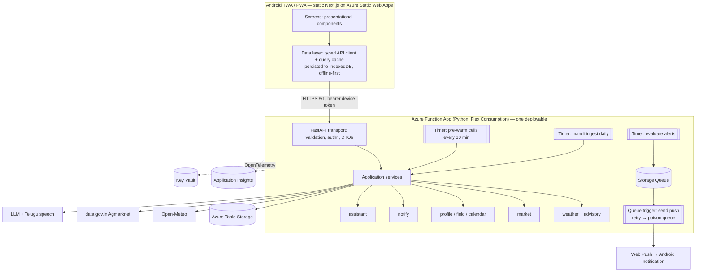

# Rythu — Target Architecture & Migration Plan

_Status: accepted 2026-10-24. Living document — update the step table as steps ship._

## Inputs (scale intent)

| Question | Answer |
| --- | --- |
| Users, next 12 months | Family pilot, 1–20 (first real user: the author's father) |
| Workload | Read-heavy weather; small writes (profile, fields, push subscriptions, alert log) |
| Planned features | Profile sync · push rain/spray alerts · mandi prices · My-Field crop calendar · "Ask Rythu" AI assistant |
| Freshness / latency | Forecast ≤ 30 min old; first useful screen < 3 s on 3G, with an offline fallback |
| Cloud / budget | Azure for Students ($100/yr credit, region-restricted) → design for ≈ $0/month |

**Implication.** At this scale the hard engineering is at the integration points (Open-Meteo, Agmarknet,
web push, an LLM), not raw throughput. We adopt the *discipline* of large consumer apps — clean layering,
stateless compute, async jobs, observability — and deliberately none of their *scale machinery*.

## Current state (2026-10-24)

```mermaid
flowchart LR
  P[Phone browser / PWA] -->|navigate ?lat&lon&crop| N[Next.js SSR on Amplify<br/>app/page.tsx: parse + fetch + fallback + render]
  P -->|typing| G[/api/geocode Next route/]
  G --> NOM[Nominatim] & OMG[Open-Meteo geocode]
  N -->|GET /weather no-store, no timeout| AG[API Gateway] --> L[Lambda handler<br/>composition rebuilt per call]
  L --> C{DynamoDB cache<br/>key 0.01°}
  C -->|miss: user waits| OM[Open-Meteo]
  P -. localStorage: place, lang .-> P
  P -. Cognito SDK: tokens unused .-> COG[Cognito]
  SW[Service worker] -. caches SSR HTML incl. frozen 'updated N min ago' .-> P
```

Keep: the backend is already hexagonal (`domain/` pure and guarded by `tests/test_domain_purity.py`,
`adapters/` implement ports, `app/` composes); compute is stateless.

| # | Weakness | Where |
| --- | --- | --- |
| W1 | Cold upstream fetch on the user's request path; cache keyed at 0.01° so it rarely hits | `services/weather/src/rythu_weather/adapters/cache.py` |
| W2 | One server component parses, validates, fetches, decides error policy and renders | `apps/web/app/page.tsx` |
| W3 | Contract + enums hand-copied in three places | `apps/web/lib/types.ts`, `app/page.tsx`, `components/WeatherScreen.tsx`, `domain/models.py` |
| W4 | No user model or server-side state | `apps/web/lib/prefs.ts`, `components/RestoreLocation.tsx` |
| W5 | No authn/authz boundary (Cognito provisioned, never verified) | `apps/web/lib/auth.ts`, `infra/rythu_infra/auth_stack.py` |
| W6 | No async/background capability | — |
| W7 | Sync boto3 inside `async def`; clients rebuilt per invocation | `adapters/cache.py`, `app/handler.py`, `adapters/open_meteo.py` |
| W8 | No observability; bugs masked as degraded 200s | `app/handler.py` (`except Exception`) |
| W9 | Unversioned API | `GET /weather` |
| W10 | Domain knowledge (crops, doses, pests, schemes) lives in the frontend bundle | `apps/web/lib/{agronomy,crops,pests,schemes}.ts` |
| W11 | No API, adapter-integration, component, contract or e2e tests | — |
| W12 | Manual, AWS-coupled delivery | `.github/workflows/ci.yml`, `infra/` |
| W13 | Design tokens exist but components bypass them; AA contrast failures | `apps/web/app/globals.css` vs `components/*` |

## Target



### Layering
Transport (FastAPI routers: validation, authn, DTO mapping — no rules) → application services (use cases,
idempotency, transactions) → domain (pure; today's rules/windows/models plus new aggregates) → repositories
(ports) with Table Storage adapters. Dependency rule points inward (Martin, *Clean Architecture*); bounded
contexts are Python packages, not services (Newman, *Building Microservices*; Evans, *DDD*). See ADR 0001.

### Data (ADR 0002)
| Table | PartitionKey | RowKey | Notes |
| --- | --- | --- | --- |
| `forecast` | cell `18.4_79.9` (0.1° ≈ model grid) | `v1` | payload, `fetchedAt`, `expiresAt` (expiry enforced in code + cleanup job) |
| `users` | `userId` | `profile` · `field#<id>` · `push#<sha(endpoint)>` | one partition per user → batch transactions; ETag optimistic concurrency |
| `alertlog` | `userId` | `<alertId>#<windowStartISO>` | idempotency: one send per alert window |
| `mandi` | `<commodity>#<district>` | `<invertedDate>#<market>` | newest-first range read |
| `cells` | `cells` | cell | pre-warm set with `lastSeen` |

No read replicas or Redis: the hot set is kilobytes. Revisit (Postgres) when cross-user queries appear.

### Async (Hohpe & Woolf, *Enterprise Integration Patterns*)
1. Pre-warm timer refreshes known cells every 30 min → users always hit cache; upstream calls scale with cells, not users.
2. Daily mandi ingest → idempotent upserts; a flaky source never sits on a user request.
3. Alert evaluation → Storage Queue → sender (per-message retry, poison queue, idempotent receiver via `alertlog`).
4. AI answers stay synchronous + streamed (a user is waiting).

### Scaling
Stateless compute; state lives in Table Storage, the queue, Key Vault, and on-device (IndexedDB + device token).
The binding constraint is shared upstream quota, so a global upstream budget (token bucket) bulkheads it
(Nygard, *Release It!*).

### APIs
`/v1/weather`, `/v1/markets/prices`, `/v1/me/{profile,fields,push-subscriptions,calendar}`, `/v1/assistant/ask`,
`/v1/content/{crops,pests,schemes}`, `/v1/geocode`, `/healthz`, `/readyz`. Pydantic → OpenAPI → generated
TypeScript (CI fails on drift). Additive-only changes within `v1` (Kleppmann, *DDIA* ch. 4).

### Resilience
Timeouts on every outbound call (Open-Meteo 4 s, geocode 3 s, Agmarknet 15 s job-only, push 5 s, LLM 20 s TTFB;
client 3 s then cached data). Background jobs: exponential backoff + jitter, ≤ 3; user path: at most one fast
retry. Idempotent PUTs, keyed push subscriptions, alert-window keys, upsert ingest. Degrade by serving stale
data labelled with its true age (Fox & Brewer: trade harvest for yield).

### Observability (*Site Reliability Engineering*)
OpenTelemetry → Application Insights (JSON logs, traces, dependency calls, correlation id header). Metrics:
`cache_result`, `upstream_latency_ms`, `upstream_budget_rejected`, `alerts_{sent,failed,deduped}`,
`ingest_rows`, `assistant_tokens`. SLOs: 99 % of weather responses non-degraded per month; 95 % of responses
< 60 min old. Email alerts on job failure, SLO burn, 80 % budget. Daily ingestion cap + $5 budget alert.

### Security (ADR 0004)
Anonymous device credentials first; `userId` comes only from the verified token (IDOR test required);
Pydantic bounds + Telangana bounding box; Key Vault + managed identity; GitHub OIDC (no stored cloud keys);
AI quotas and grounding; DPDP Act: minimal data, consent screen, delete-my-data.

### Delivery
Unit (domain) · adapter contract tests on Azurite · API tests (TestClient) incl. authz · OpenAPI type-drift
check · component tests · 3–5 Playwright flows · Lighthouse CI budgets. CI: lint, types, tests, build,
`bicep build` + `what-if`. CD: `main` → dev; prod behind a GitHub Environment approval. Config via
`pydantic-settings`; IaC in Bicep; rollback = redeploy previous SHA.

### Current → target

| Area | Current | Target | Solves |
| --- | --- | --- | --- |
| Weather latency | Upstream on user path | Pre-warmed cells; client renders cache first | < 3 s on 3G (W1) |
| Upstream cost | ∝ users × 0.01° keys | ∝ 0.1° cells, global budget | quota abuse / cost |
| Frontend data | SSR fetch-and-render | Typed client + persisted query cache | offline-first, true data age (W2) |
| Contract | Hand-copied ×3 | OpenAPI-generated + CI drift check | drift (W3) |
| User state | localStorage / URL | `users` table + device auth | sync, alerts, calendar (W4, W5) |
| Background work | None | Timers + queue + DLQ | alerts, ingest, refresh (W6) |
| Observability | None | OTel, SLOs, alerts | know before the user does (W8) |
| API | Unversioned | `/v1`, additive-only | old clients keep working (W9) |
| Domain content | Frontend bundle | `/v1/content` | one source of truth (W10) |
| Delivery | Manual CDK / AWS | Bicep + OIDC + gated CD / Azure | repeatable deploys (W12) |

### Intentionally not doing yet
- **Microservices / Kubernetes / service mesh** — one developer, one deployable.
- **Kafka / Service Bus / event sourcing / CQRS** — a Storage Queue covers the only async flow.
- **Read replicas, sharding, Redis, extra CDN** — kilobyte dataset; Redis Basic ≈ $16/mo for no gain.
- **API Management** — cost and latency; app-level validation + upstream budget suffice.
- **Multi-region / DR** — pilot tolerates a day's loss; weekly blob export.
- **Logical/vector clocks, consensus** — single writer per user partition; ETags suffice.
- **Image-based pest diagnosis, fine-tuned models, phone OTP, Storybook, native rewrite** — safety/cost/effort ≫ benefit at 20 users.

## Front-end design system

Measured WCAG contrast failures today: stone-400 on white **2.52** (11 uses — source stamp, window notes);
white on sky-500 **2.77** (sunny hero incl. the main % and an 11 px disclaimer); white on green-600 **3.30**
(GPS button); stone-500 on `--bg` **4.29**. Also: fixed `<html lang="te">` in English mode, "Why?" toggle
lacks `aria-expanded`, the hourly chart has no text alternative, crop chips are full-reload `<a>` links,
and 🫛 (Emoji 15) renders as tofu on older Android.

### Tokens (every text/background pair ≥ 4.5 : 1, computed)
| Group | Tokens |
| --- | --- |
| Surface | `surface` #f4f2ec · `surface-raised` #fff · `surface-sunken` stone-100 |
| Text | `text` #1c1917 · `text-secondary` stone-600 #57534e (6.81 on surface / 7.63 on white) · no tertiary |
| Brand | `brand` green-700 (5.02) · `brand-strong` green-800 (white 7.13) · `on-brand` #fff |
| Status bg/fg | info sky-50/sky-800 (7.09) · caution amber-50/amber-900 (8.75) · act red-50/red-800 (7.60) · success green-100/green-800 (6.49) · warn orange-100/orange-800 (6.38) |
| Sky hero | clear: sky-700→emerald-700 (5.93/5.48) · cloudy: slate-600 (7.58) · rain/storm unchanged (pass) |
| Type (17 px base) | caption 14 · body-sm 15 · body 17 · title-sm 20 · title 24 · display 32 · hero 72; floor 14 px; Telugu line-height 1.55 |
| Space | 4 · 8 · 12 · 16 · 24 · 32 · 48 |
| Radius | 8 · 12 · 16 · 24 (card) · full |
| Elevation | `shadow-1` · `shadow-2` · `shadow-hero` |
| Touch | ≥ 48 × 48 px |
| Motion | 100 / 200 ms; reduced-motion respected |
| Icons | inline SVG subset (Lucide, MIT) for chrome; emoji only where decorative |

### Components (Frost, *Atomic Design*)
- **Atoms** — `Text`, `Icon`, `Button`, `Chip`, `Badge`, `Card`, `Skeleton`, `ListenButton`
- **Molecules** — `SectionHeader`, `StatTile`, `StatusBanner`, `Disclosure`, `SegmentedControl`, `SearchField`, `ListRow`
- **Organisms** — `AppHeader`, `BottomNav`, `WeatherHero`, `HourlyRainChart` (+ accessible table), `DailyOutlook`, `AdviceCard`, `SchemeCard`, `FertilizerCalculator`, `LocationSheet`
- **Template** — `ScreenLayout` (safe areas, landmarks)
- **Pages** — thin containers calling data hooks; presentational components never fetch.
- **State** — TanStack Query + IndexedDB persister (ADR 0003); app state = language + profile.
- **Gallery** — `/dev/ui` route renders every component state.

### Performance budgets
Instant first paint from SW shell + IndexedDB cache with on-device age; skeletons only on first install;
optimistic crop/village switch. ≤ 170 KB gz first-load JS; Telugu font 2 weights; lazy-load calculator,
pest guide, assistant. Lighthouse CI: a11y ≥ 95, mobile performance ≥ 85.

## Migration steps

Each step is one commit; the app works after every step; AWS runs until cutover. ⭐ = highest leverage.

| Step | Change | Behaviour change | Status |
| --- | --- | --- | --- |
| ⭐ S0 | Safety net: CI lint/tsc/build/audit, Dependabot fixed, Next 16.4.2 + audited deps, this document | none | **done** |
| ⭐ S1 | Settings module, structured logging, correlation id, outbound timeouts, stop leaking `reason` | `reason` removed from degraded body; degraded = `no-store`; Open-Meteo deadline 10 s → 4 s; Next fetch capped at 10 s | **done** |
| ⭐ S2a–d | Truthfulness: future-only "today" · drop past days · enforce cache expiry · 0.1° cells + Telangana bbox | yes — hero = next-12-h max; saved copy ≤ 6 h; coverage lat 15.7–20.0 / lon 77.1–81.5 | **done** |
| S3 | FastAPI transport + `/v1/weather`, `/healthz` (golden test vs. old serializer) | none (dev server now FastAPI; `/docs`) | **done** |
| S4 | OpenAPI → generated TS types + CI drift check | none | **done** |
| S5 | Repository ports + Table Storage adapter, Azurite contract tests | none | planned |
| ⭐ S6 | Azure foundation: Bicep, Function App, App Insights, Key Vault, budget, OIDC, deploy to dev | none (AWS live) | planned — needs allowed regions |
| ⭐ S7 | Pre-warm timer, cell registry, global upstream budget | faster; ≤ 30 min staleness | planned |
| ⭐ S8a | Client data layer behind a flag (TanStack Query, IndexedDB, on-device age) | none while off | planned |
| S8b | Static export → Static Web Apps; app-shell service worker | SSR ends | planned |
| S9 | `/v1/geocode`; search-on-submit (Nominatim policy) | search on tap | planned |
| S10 | Cutover to Azure prod, 7-day dual run, `cdk destroy` (explicit approval) | none | planned |
| S11a | Tokens + primitives at today's values + lint rule (pixel-identical) | none | planned |
| S11b–e | Contrast, type floor, SVG icons, lang/ARIA, per-screen migration (screenshots each) | visual | planned |
| ⭐ S12 | Android TWA → Play internal testing → father installs; start 12-tester closed test | new channel | planned |
| S13 | Device auth + `/v1/me/profile` sync; remove Cognito | server-restored profile | planned |
| S14 | Push alerts (subscriptions, evaluation, queue, sender, alert log) | new | planned |
| S15 | Mandi prices + MSP comparison (after confirming data.gov.in API access) | new | planned |
| S16 | My-Field crop calendar | new | planned |
| S17 | "Ask Rythu" grounded assistant (Telugu voice, quotas, KCC fallback, eval set) | new | planned |

## Decision records
- [0001 — Modular monolith on Azure Functions](adr/0001-modular-monolith-on-azure-functions.md)
- [0002 — Azure Table Storage as the primary store](adr/0002-azure-table-storage.md)
- [0003 — Client data layer: TanStack Query + IndexedDB](adr/0003-client-data-layer-tanstack-query.md)
- [0004 — Anonymous device credentials before accounts](adr/0004-anonymous-device-auth-first.md)
- [0005 — Android via Trusted Web Activity](adr/0005-android-trusted-web-activity.md)

Research behind the feature list: [`../farmer-problems-2026-10.md`](../farmer-problems-2026-10.md) (extends
[`../farmer-needs-research.md`](../farmer-needs-research.md)).
